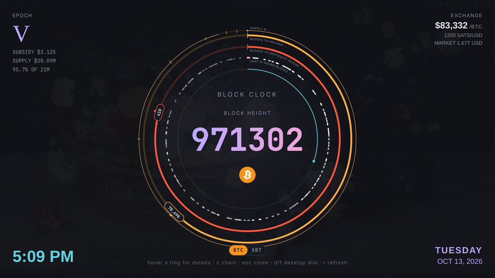

# Block Clock

A Bitcoin timechain dial for the [Omarchy](https://omarchy.org) shell, inspired by
[timechaincalendar.com](https://timechaincalendar.com). The BTC/USD price sits in your bar.
Click it for the full dial, keep the dial on your desktop, or open it full screen.



The rings, outside in, each named along its arc from 12 o'clock:

| Ring | Shows |
|---|---|
| Supply | bitcoin mined so far, out of 21 M; ticks mark each halving (50 %, 75 %, …) |
| Blocks to halving | progress through the current subsidy epoch; a pill at the end shows blocks left |
| Blocks to difficulty adjustment | progress through the current 2,016-block period; a pill shows blocks left |
| Last 24 hours | one tick per block, placed by time; the newest is pink |
| Block timer | time since the last block (hover for the exact time); teal for the first 10 minutes, then amber, then red |

**Hover any ring or pill** and the centre of the dial explains it: the halving's estimated
month, the difficulty adjustment's date and expected change, the average time between
blocks, the pool that found the last block.

The corners show the epoch, subsidy and supply; the BTC/USD price, sats per dollar and
market cap (and the hashrate, if you turn it on); and the time and date.

All data comes from the public [mempool.space](https://mempool.space) REST API, or from
your own mempool instance.

### Two chains: BTC and XBT

The dial follows either **Bitcoin** (SHA-256) or **XBT**, Bitcoin BLAKE2b, the fork that
switched proof of work at block 961,640. Flip between them with the **BTC | XBT** switch at
the top of the dial, or press **`c`**. Both share Bitcoin's history, halving schedule and
21 M cap, so every ring works the same way; on XBT three gold nodes circle the logo once a
minute ("nodes over miners"; hover it; they hold still on the desktop dial and in the
screensaver), the caption reads "BLOCK CLOCK · XBT", and the bar shows
`XBT $…`. XBT data comes from its explorer, [mempool.lazarus-xbt.xyz](https://mempool.lazarus-xbt.xyz);
its price is that explorer's figure and has not been checked against an exchange. Each
chain's last data is cached, so switching is instant.

## Install

```sh
omarchy plugin add https://github.com/perfect-hero/mondo-block-clock.git --enable
```

`--enable` puts the widget in your bar. **The bar entry is the plugin's on/off switch:**
removing the widget from the bar also stops the background service, the desktop dial,
the fullscreen view and the screensaver.

Update with `omarchy plugin update io.github.perfect-hero.mondo-block-clock`.

Remove the installed copy with:

```sh
omarchy plugin remove io.github.perfect-hero.mondo-block-clock
```

## Use

| Where | What |
|---|---|
| Bar widget | the BTC/USD price, `$81,685`; it pulses when a block arrives and dims when the data is more than 2 minutes old; the tooltip has the block height. Works in horizontal and vertical bars. |
| Left-click | open the popup dial |
| Right-click | show or hide the desktop dial (off by default) |
| Middle-click | refresh now |
| Desktop dial | sits on the wallpaper, under your windows. Click it to give it the keyboard; double-click for fullscreen |
| Fullscreen | the keybind below, or `f` in the popup or on the desktop dial; click anywhere to close |
| Screensaver | the fullscreen dial after you are idle (see [Screensaver](#screensaver)); any key, click or mouse movement closes it |

Keys, wherever the dial has the keyboard:

| Key | Popup | Fullscreen | Desktop dial (after a click) |
|---|---|---|---|
| `Esc` / `q` | close | close (the desktop dial too) | hide the desktop dial |
| `f` | fullscreen | back to the desktop dial | fullscreen |
| `d` | show the desktop dial (closes the popup) | back to the desktop dial | fullscreen |
| `c` | switch BTC / XBT | switch BTC / XBT | switch BTC / XBT |
| `r` | refresh | refresh | refresh |

The popup and fullscreen take the keyboard when they open, wherever the mouse is.

### Keybind for fullscreen

Add to `~/.config/hypr/bindings.lua`:

```lua
o.bind("SUPER + ALT + B", "Timechain calendar", "omarchy-shell shell toggle io.github.perfect-hero.mondo-block-clock")
```

The keybind (and anything else that "summons" the plugin) opens the **fullscreen view,
not the popup**. The popup is only reached by clicking the bar widget. That is how the
shell routes plugins that have an overlay.

### Screensaver

```sh
omarchy bar set io.github.perfect-hero.mondo-block-clock screensaver true
omarchy toggle screensaver        # turn Omarchy's terminal screensaver off, so only one runs
```

The dial opens fullscreen after the same idle time as Omarchy's screensaver
(`idle.screensaver` in `~/.config/omarchy/shell.json`, default 150 s). It does not open
while the screen is locked, while stay-awake is on (`omarchy toggle idle`), or while a
video or other idle inhibitor is active. Locking is unchanged: Omarchy's `idle.lock` timer
still locks the screen.

Try it without waiting: `omarchy-shell io.github.perfect-hero.mondo-block-clock screensaver`.

### Optional: no fade on the desktop dial

If Hyprland's layer animation bothers you when the desktop dial appears, add to your
Hyprland config:

```lua
hl.layer_rule({ match = { namespace = "mondo-block-clock" }, no_anim = true, animation = "none" })
```

## Settings

Change settings with `omarchy bar set`, for example:

```sh
omarchy bar set io.github.perfect-hero.mondo-block-clock desktopAnchor top-right
omarchy bar set io.github.perfect-hero.mondo-block-clock desktopSize 360
```

They take effect immediately. Prefer this over editing `~/.config/omarchy/shell.json` by
hand: the shell does not always notice hand edits until it restarts.

| Key | Default | Notes |
|---|---|---|
| `apiBase` | `https://mempool.space` | any mempool instance, e.g. one on your own node |
| `refreshIntervalSec` | `30` | 15–300; how often to check for a new block (±20 % jitter) |
| `priceRefreshSec` | `120` | 60–900; the bar price; also refreshed when a dial opens |
| `showTimerRing` | `true` | the 10-minute block timer ring |
| `showHashrate` | `false` | adds the 3-day hashrate to the corner stats |
| `desktopWidget` | `false` | show the desktop dial |
| `desktopScreen` | `""` | empty = every monitor; or a monitor name such as `DP-1` (falls back to the first monitor if that one is unplugged) |
| `desktopAnchor` | `center` | `center`, `top-left`, `top-right`, `bottom-left`, `bottom-right` |
| `desktopSize` | `480` | 240–1200; dial diameter in px |
| `desktopMargin` | `48` | 0–400; distance from the anchored edges in px |
| `desktopOpacity` | `90` | 20–100; percent |
| `desktopStats` | `true` | corner stats around the desktop dial; off gives a round dial only |
| `timeFormat` | `h:mm AP` | Qt time format for the corner clock |
| `screensaver` | `false` | use the fullscreen dial as the screensaver |
| `chain` | `btc` | `btc` or `xbt`; the switch and `c` change it |
| `xbtApiBase` | `https://mempool.lazarus-xbt.xyz` | the mempool instance used for XBT |

The desktop dial stays clear of the bar on whichever edge the bar is.

## Command line

```sh
omarchy-shell io.github.perfect-hero.mondo-block-clock status               # JSON: height, online, stale, price, …
omarchy-shell io.github.perfect-hero.mondo-block-clock refresh
omarchy-shell io.github.perfect-hero.mondo-block-clock desktop toggle       # or show / hide
omarchy-shell io.github.perfect-hero.mondo-block-clock screensaver          # open the screensaver now
omarchy-shell io.github.perfect-hero.mondo-block-clock chain toggle         # or btc / xbt
omarchy-shell shell toggle io.github.perfect-hero.mondo-block-clock         # fullscreen
```

In scripts and keybinds, `omarchy-shell -q` exits quietly if the shell is mid-reload.

## Network and privacy

- One background service does all fetching, however many monitors and dials you have.
- About 3,600 small requests a day at the default settings: the tip height every ~30 s,
  the price every 2 minutes, block details when a block arrives, and difficulty. Rate limits and
  outages back off (up to 5 minutes; network errors retry within a minute), and the
  service checks again right after the machine wakes from sleep.
- mempool.space sees your IP address. Point `apiBase` at your own mempool instance if you
  would rather it didn't.
- A small cache in `~/.local/state/mondo-block-clock/state.json` lets the dial come back
  instantly after a restart. Nothing else is written.

## Development

- `tests/run.sh` runs the model tests (`node --test`) and `omarchy plugin validate`.
- `tests/fixture_server.py` serves a synthetic chain on `127.0.0.1:8787` for testing
  blocks, rate limits and outages offline; point `apiBase` at it.
- Shell hot-reload rebuilds the plugin from **stale** code, so run `omarchy restart shell`
  after editing QML.
- `DESIGN.md` has the full design and test results.

## License

MIT. Not affiliated with timechaincalendar.com, mempool.space or the XBT project. The
Bitcoin logo is in the public domain.
